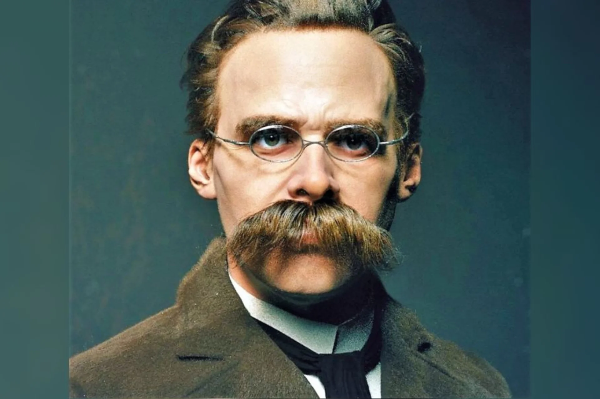

# über-mustache

Friedrich Nietzsche had one of the greatest mustaches in human history. I thought it deserved physics.

This is a single html page where you can grab his mustache, fling it around, comb it with your cursor, and pull on his ears. He gets happy, he gets sad, he cries, he quotes himself at you. Mostly he just suffers, which honestly tracks.

## what you can do to him

- **drag** the mustache. every hair is simulated, all 168 of them
- **fling** it and let go. it goes boing
- **hover** over it to comb it
- **grab his ears** and stretch them. they snap back
- **double click** or hit **space** to make everything bounce
- **click his face** to tickle him. he does not like it. he says so

His mood changes on its own every few seconds. When he's sad the mustache droops and he starts crying. When he's happy the tips curl up and he blushes. When you tickle him he loses all philosophical composure.

## running it

Open `index.html` in a browser. That's it. No npm install, no build step, no 400MB node_modules folder. The photo is baked into the file so it works straight from your desktop.

Needs WebGL, so anything from the last decade is fine.

## how it works

- three.js for rendering
- the mustache is a bunch of verlet strands rendered as little tubes
- the face is a subdivided plane that gets warped to make him smile or frown
- the ears are also just warped photo, on springs
- all the sounds are generated with WebAudio oscillators, no audio files

## faq

**why?**
he would have wanted this. probably. hard to say. the man had opinions.

**is this historically accurate?**
his ears were not this stretchy as far as I know

**the quotes are out of context**
so was his whole life after his sister got hold of his notes

**what does god is dead have to do with a mustache**
nothing. he's just sad

## license

do whatever you want with it. the mustache belongs to everyone now.
